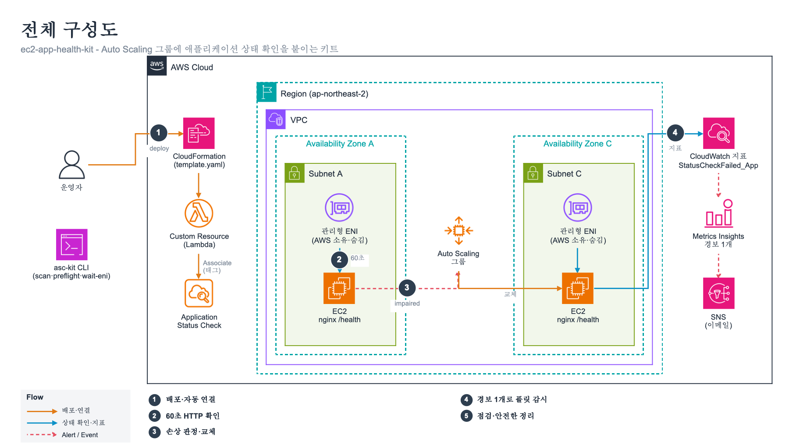

# ec2-app-health-kit

Attach **EC2 application status checks** to your existing Auto Scaling groups with one CloudFormation stack, and clean them up without getting stuck.

EC2 application status checks (Aug 2026) let EC2 call an HTTP(S) endpoint on each instance every 60 seconds. When the app fails, the instance's application status becomes `impaired` and the Auto Scaling group replaces it — **no load balancer and no change to the group's health check type** (`EC2` is enough).

The feature is good. Rolling it out across real accounts has a few rough edges, and this kit fills them:

| Gap we hit | What the kit does |
|---|---|
| CloudFormation can **create** `AWS::EC2::ApplicationStatusCheck` but has **no resource to associate it** with instances or tags. A template alone monitors nothing. | A custom resource associates the check with instance tags (Auto Scaling group names by default) on create/update, and disassociates it on delete. |
| The Lambda Python runtime's bundled boto3 can **lag new EC2 APIs** (python3.13 shipped boto3 1.42.97 without these calls). | The custom resource falls back to a SigV4-signed EC2 Query API call using the botocore already in the runtime. No layer, still one template. |
| `AssociateApplicationStatusCheck` reports per-target failures in `UnsuccessfulResults` instead of raising. | The custom resource treats any unsuccessful result as a failure, so the stack never says "done" while nothing is attached. |
| The check's metric is per instance, and Auto Scaling replaces instances. | One CloudWatch **Metrics Insights alarm** on the per-check metric; each instance is a contributor, so replaced instances drop out and new ones join automatically. |
| Instances look `impaired` if their security group only allows the load balancer. | `asc-kit preflight` checks that the port is open from inside the VPC. |
| After deleting a check, **AWS-managed ENIs stay for hours** and block deleting the security group and subnets (`DependencyViolation`). They are hidden from normal ENI listings and cannot be detached. | `asc-kit wait-eni` polls with `IncludeManagedResources` until they are released, so teardown scripts know when to continue. |



## Measured on a test account (ap-northeast-2, 2026-10-07)

Two `t4g.small` instances behind nothing but an Auto Scaling group (`HealthCheckType: EC2`), nginx serving `/health`.

| Step | Time |
|---|---|
| Stack create (check + association + alarm) | 66 s |
| Stack create → both instances `ok` (no console steps) | 5 min 13 s (grace period 300 s) |
| Fault injected (`/health` returns 500) → `impaired` | _see results below_ |
| → Auto Scaling takes the instance out of service | _see results below_ |
| → Alarm `ALARM` | _see results below_ |
| → Replacement instance `ok`, alarm back to `OK` | _see results below_ |
| Check deleted → managed ENIs released | about **3 h 50 min** (earlier run, 2026-10-06) |

## Quick start

### 1. Find groups that are not covered

```bash
uv tool install git+https://github.com/jogilsang/ec2-app-health-kit   # or: uv run asc-kit ... from a clone
asc-kit --profile my-profile --region ap-northeast-2 scan
```
```
AutoScalingGroup  HealthCheckType  LoadBalancer  AppChecks  Verdict
web-asg           EC2              no            -          NO_APP_CHECK
api-asg           ELB              yes           -          ELB_ONLY
```
`NO_APP_CHECK` means the group only replaces instances on EC2 status checks: a hung app stays in service.

### 2. Check prerequisites

The check is sent from an AWS-managed ENI inside your VPC, so the instance security group must accept the port from the VPC.

```bash
asc-kit preflight --asg web-asg --port 80
```

### 3. Deploy

```bash
aws cloudformation deploy --stack-name web-app-health \
  --template-file template.yaml --capabilities CAPABILITY_IAM \
  --parameter-overrides TargetTagValues=web-asg Path=/health AlarmEmail=ops@example.com
```

| Parameter | Default | Notes |
|---|---|---|
| `TargetTagValues` | (required) | Comma-separated. With the default key these are Auto Scaling group names. Max 50. |
| `TargetTagKey` | `aws:autoscaling:groupName` | Any instance tag key works, for example `app-tier`. |
| `Protocol` / `Port` / `Path` | `http` / `80` / `/health` | |
| `StatusCodeMatcher` | `200` | For example `200-299`. |
| `TimeoutSeconds` | `6` | Must be less than the 60 s interval. |
| `FailureThreshold` / `SuccessThreshold` | `2` / `2` | |
| `GracePeriodSeconds` | `300` | Seconds after launch before checking. Set longer than your boot time. |
| `AlarmEmail` | empty | Optional SNS email (confirm the subscription mail). |

### 4. Watch

```bash
asc-kit status --asg web-asg
```
```
InstanceId           Status    CheckId       CheckStatus  Reason                HttpCode
i-0123456789abcdef0  ok        asc-f5cbba98  ok           ResponseCodeMatched   200
i-0fedcba987654321   impaired  asc-f5cbba98  impaired     ResponseCodeMismatch  500
```

### 5. Tear down

```bash
aws cloudformation delete-stack --stack-name web-app-health      # disassociates, then deletes the check
asc-kit wait-eni --vpc-id vpc-0abc...                             # only if you are also deleting the VPC/SG
```
Deleting the check is quick. The managed ENIs are released by AWS later (hours in our tests). If you delete the security group or subnets in the same pipeline, wait for `wait-eni` first.

## Things worth knowing

- `describe-application-status-checks` did **not** return `TargetTagAssociations` in our tests, even right after a successful association. `asc-kit scan` therefore reads coverage from the instances (`describe-application-status`), which is what actually matters.
- `describe-application-status` returns `ApplicationStatuses.Instances[]`, not the shape shown in some doc examples.
- Limits: 50 checks per account, 50 tag associations per check. Interval is fixed at 60 s.
- Pricing: per managed ENI (subnet × security group combination) per AZ-hour, plus standard CloudWatch charges. See the [user guide](https://docs.aws.amazon.com/AWSEC2/latest/UserGuide/application-status-checks.html).
- If you use `aws login` credentials, the CLI needs `botocore[crt]` (installed by default here).

## Development

```bash
uv sync
uv run pytest        # custom resource is tested straight from template.yaml; AWS calls are mocked
```

## References

- [Application status checks — Amazon EC2 User Guide](https://docs.aws.amazon.com/AWSEC2/latest/UserGuide/application-status-checks.html)
- [AWS::EC2::ApplicationStatusCheck — CloudFormation](https://docs.aws.amazon.com/AWSCloudFormation/latest/TemplateReference/aws-resource-ec2-applicationstatuscheck.md)
- [Metrics Insights alarms — CloudWatch](https://docs.aws.amazon.com/AmazonCloudWatch/latest/monitoring/cloudwatch-metrics-insights-alarm-create.html)

## License

MIT
